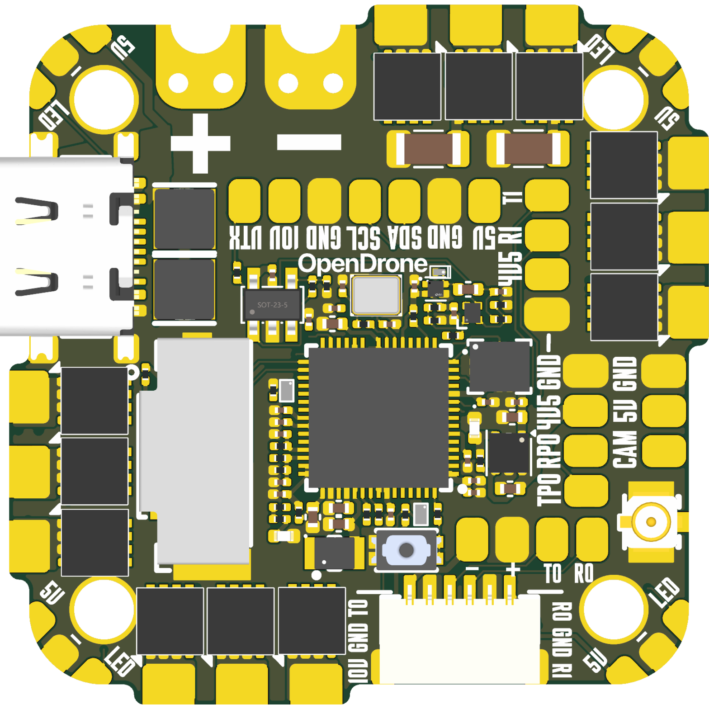
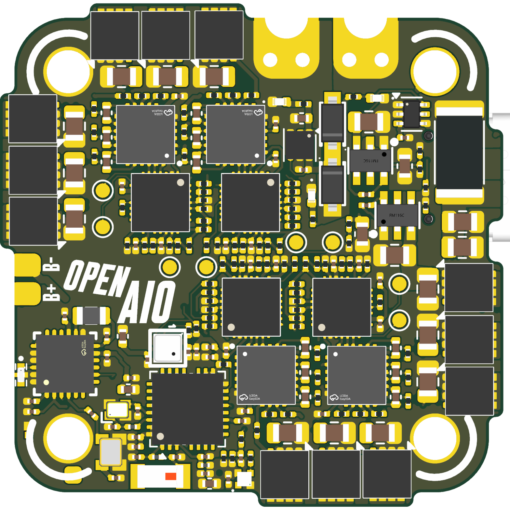

# OpenAIO

An all-in-one for 85 mm whoops, 2.5 inch cinewhoops and 3 inch freestyle: RP2354A flight controller, four AM32 ESC channels and an ExpressLRS 2.4 GHz
receiver on one 8-layer HDI board with 25.5 x 25.5 mm mounting. Its circuits follow OpenFC-Lite-Mini, OpenESC-20x20 and
OpenRX-Lite.

## Why

Flight controller, ESC and receiver are usually three boards joined by connectors and wiring. On a small quad the
stack costs weight and height, and the connectors are where builds fail. OpenAIO puts all three on one board and keeps
the firmware stock. The market research linked under Prior art covers competing AIOs.

## Specifications

From the design files. Not manufactured yet.

| | |
|---|---|
| Mounting | 25.5 x 25.5 mm, four 3.0 mm holes |
| Board | 35.4 x 35.4 mm, 8 layers HDI 1+6+1, 0.997 mm, 1 oz copper on all layers, ENIG |
| Input | 3S to 6S LiPo, 9.0 to 25.2 V; 2S is not supported (gate driver VCC, see research/INPUT_RANGE.md) |
| Input protection | None: no reverse polarity protection, no TVS. Fit a low-ESR electrolytic of at least 35 V on the battery leads |
| Current rating | Not established; no measurement exists |
| Flight controller | RP2354A, BMI270 IMU, BMP580 barometer, USB-C |
| OSD and blackbox | Analog PIO framebuffer OSD, microSD card |
| ESC | 4x AM32, AT32F421G8U7 + NSG2065Q + 6x DOY180N03T (30 V) per channel, one shared current sensor |
| Receiver | ExpressLRS 2.4 GHz, ESP32-C3 + SX1281, u.FL antenna |
| Outputs | +10V (always on with a battery) on SH-6 and pads, +5V and +4v5 pads, WS2812 strip pads, buzzer pads |
| Firmware | Betaflight, AM32, ExpressLRS, stock upstream |

Technical write-up, part list and layout constraints: [AGENTS.md](AGENTS.md). Pinout and firmware:
[firmware/](firmware/README.md).

## Constraints

- 25.5 x 25.5 mm mounting, the whoop and toothpick standard.
- Runs stock firmware: Betaflight on the FC, AM32 per ESC channel, ExpressLRS on the receiver. No forks.
- Parts come from the shared library first; assembly from LCSC parts, extended parts kept to a minimum.
- 8-layer HDI 1+6+1 with filled microvias; fabrication limits are in [research/NEXTPCB.md](research/NEXTPCB.md).

## Prior art

- [OpenFC-Lite-Mini](https://github.com/OpenDrone-hw/OpenFC-Lite-Mini): the RP2354A flight controller
- [OpenESC-20x20](https://github.com/OpenDrone-hw/OpenESC-20x20): the AM32 4-in-1 power stage
- [OpenRX Lite](https://github.com/OpenDrone-hw/OpenRX-Lite): the ELRS receiver
- [Market research](https://app.notion.com/p/3f5fe06764e1818e9158c512edd58138): competing toothpick and whoop AIOs, June 2026
- [Part alternatives](https://app.notion.com/p/3f5fe06764e1819eade0dc5bfbfdff7c): ESC-stage part alternatives, gate driver and FET options, March 2026
- [Current sensing](research/shunt/MARKET_AND_LITERATURE.md): shunt against copper sensing, market and literature

Notes: [input range](research/INPUT_RANGE.md), [pin constraints](research/IO-CONSTRAINTS.md),
[board data and copper model](research/ROUTING.md).

## Design questions

- **Thermal.** Four power stages next to an MCU and a radio on 25.5 mm square, with no airflow guarantee. What is the
  continuous current budget on 1 oz copper? The copper loss model in [research/ROUTING.md](research/ROUTING.md) is the
  only number so far.
- **RF isolation.** A 2.4 GHz receiver next to four switching power stages: ground plane and antenna placement are
  untested.
- **Open board issues.** The LED strip stage inverts, the ESC MCUs run from USB without gate drive power, and SBUS on
  SH-6 shares a net with the ELRS TX: [firmware/ISSUES.md](firmware/ISSUES.md).

## In the line

What pairs with what, and what is available:
[opendrone.be](https://opendrone.be).

## Contributing

KiCad files cannot be merged, so say what you intend to change before you do,
on [Discord](https://discord.gg/v3sWmTcx3R). How everything works:
[CONTRIBUTING.md](CONTRIBUTING.md).

A repository holds design files only. Sourcing (suppliers, prices, quotes, RFQs, contacts) is handled by Incutec and never lives in OpenDrone repositories.

## License

Hardware licensed under [CERN-OHL-S-2.0](https://ohwr.org/cern_ohl_s_v2.txt),
see [LICENSE](LICENSE).
